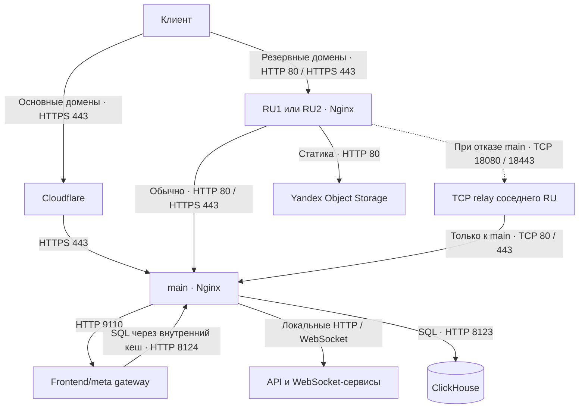

# Серверная схема WotStat

Здесь хранятся конфиги серверов и сетевой обвязки. Приложения и их деплой живут
в отдельных репозиториях.

**main** хранит данные и запускает приложения. **RU1 и RU2** дают резервные входы
к тем же сервисам и кешируют ответы. Копий базы и приложений на RU нет.

На схеме показан один входной RU; для второго путь устроен так же.

## Основной сервер

Nginx распределяет запросы сайта, аналитики, позиций, виджетов и установщика
между приложениями. Статические файлы фронтенда отдаёт с диска, HTML и картинки
превью — через frontend/meta gateway. Если gateway недоступен, сайт получает
локальную SPA, а для превью можно использовать сохранённую картинку.

Публичные SQL-запросы идут через Nginx к ClickHouse. Общий кеш снижает нагрузку
на базу; на публичном входе также действуют ограничения запросов. Для meta-сервиса
есть отдельный внутренний вход на порту 8124: он использует тот же кеш,
но не публичные ограничения.

Loki принимает логи, Grafana служит для мониторинга. Docker отправляет логи
контейнеров в локальный Loki.

## Резервные входы

Cloudflare обслуживает DNS резервных доменов без проксирования: клиент приходит
сразу на выбранный RU. Обычный путь — `клиент → RU → main`. Если прямой запрос
не удаётся, RU пробует `клиент → RU → соседний RU → main` и временно запоминает
отказ прямого пути.

Соседний RU принимает такие соединения на отдельных TCP relay-портах:
18080 для HTTP и 18443 для HTTPS. Relay всегда идёт только на main, поэтому
запрос не может зациклиться между RU. Эти порты доступны только соседнему RU.
HTTPS до main проходит через relay без расшифровки на соседнем сервере.
Уже открытое соединение при обрыве клиенту нужно установить заново.

Резервные домены в зоне `wotstat.info` настроены на обоих RU; вход выбирается DNS.
`mtstat.info` и его поддомены повторяют эти входы и также настроены на обоих RU;
сейчас их DNS указывает на RU1. `wotstat-proxy.ru` и `positions.wotstat-proxy.ru`
остаются входами только на RU1, но используют тот же резервный маршрут. Для
`http://positions.wotstat-proxy.ru` намеренно сохранён HTTP, включая путь до main.
Статика, виджеты и CEF-файлы из Object Storage идут через RU напрямую в хранилище.

## Кеши и сертификаты

RU кешируют страницы и файлы независимо друг от друга. Общий SQL-кеш работает
на main, RU и в Cloudflare Worker для `wotstat.info/api/db/*`. Он предназначен
только для публичных данных: приватные и зависящие от пользователя запросы
должны проходить без общего кеша.

У каждого RU свои сертификаты Certbot. Для доменов зон `wotstat.info` и
`mtstat.info` они продлеваются через DNS Cloudflare независимо от того,
на какой RU указывает DNS.
После продления Nginx перечитывает сертификаты. Токены и закрытые ключи
хранятся на серверах, вне репозитория.

## Где что лежит

| Путь | Назначение |
| --- | --- |
| [etc/nginx](etc/nginx) | Nginx основного сервера: входы сервисов и кеши |
| [etc/nginx-ru](etc/nginx-ru) | Общая конфигурация RU: резервные домены, кеши и relay |
| [scripts/configure-ru.py](scripts/configure-ru.py) | Подставляет IP main и соседа в шаблоны конкретного RU |
| [clickhouse](clickhouse) | Настройки ClickHouse и SQL начальной установки |
| [cloudflare/query-cache](cloudflare/query-cache) | Worker кеша публичных SQL-запросов |
| [etc/docker/daemon.json](etc/docker/daemon.json) | Хранилище Docker и отправка логов |
| [ufw](ufw) | Правила firewall отдельно для main и RU |
| [certbot](certbot) | Hook перечитывания сертификатов Nginx после продления |
